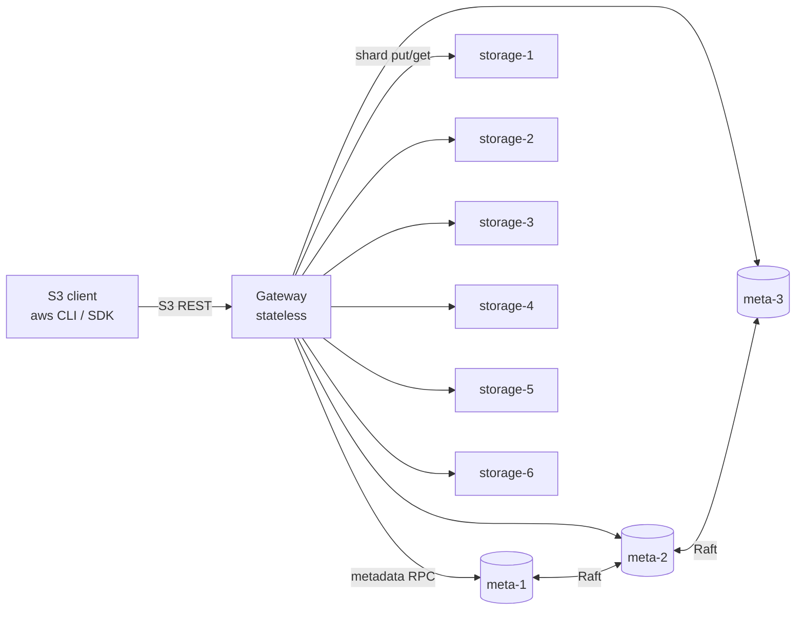
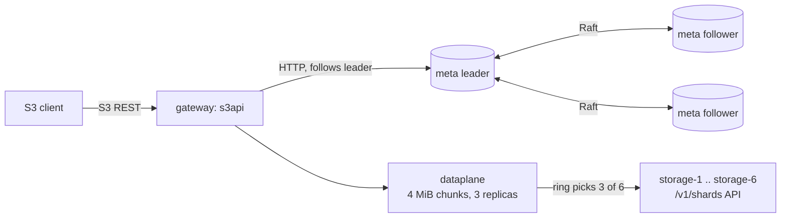

# S3-Object-Store

A distributed, S3-compatible object store written in Go: a stateless gateway,
a 3-node Raft metadata service, and storage nodes holding content-addressed
shards protected by Reed-Solomon erasure coding (4+2) or 3x replication.

> **Status: M3 (distributed storage).** Metadata is replicated across a
> 3-node Raft cluster. Every chunk is stored as 3 replicas on distinct
> storage nodes chosen by a consistent-hash ring, and a rebalancer moves
> shards when a node is added. Erasure coding (M4), multipart, repair and GC
> (M5), auth and metrics (M6) are not built yet.

## Architecture (target)



* **Gateway**: speaks a subset of the S3 REST API and streams data; it never
  buffers a whole object.
* **Metadata**: buckets, keys, chunk/shard locations and multipart state, with
  linearizable writes through Raft and BoltDB as the state machine.
* **Storage nodes**: immutable shards addressed by SHA-256, fsynced before
  being acknowledged and verified on every read.

### What runs today (M3)



Without `-meta` and `-storage`, the gateway runs single-node, with metadata
and one copy of each shard in `-data`.

## Supported S3 API

| Area | Operations |
|---|---|
| Buckets | CreateBucket, DeleteBucket, HeadBucket, ListBuckets, GetBucketLocation |
| Objects | PutObject, GetObject (single `Range`, `response-*` overrides, conditional headers), HeadObject, DeleteObject |
| Listing | ListObjectsV2 with `prefix`, `delimiter`, `max-keys`, `start-after`, continuation tokens, `encoding-type=url` |
| Integrity | `Content-MD5`; `x-amz-checksum-{crc32,crc32c,crc64nvme,sha1,sha256}` as a header or an aws-chunked trailer; `x-amz-content-sha256` when it is a real digest |
| Uploads | Plain bodies and `aws-chunked` streaming bodies (signed or unsigned, with or without trailers) |

The API uses path-style addressing only. These return `NotImplemented`:
multipart upload (M5), CopyObject, ListObjects v1, versioning, ACLs, tagging
and the other bucket subresources. Authentication is not checked until M6.

## Metadata replication (Raft)

* **State machine.** Every mutation is a `Command` (CreateBucket,
  DeleteBucket, PutObject, DeleteObject) carrying its own timestamps, so
  applying it is deterministic. The single-node store and the Raft state
  machine run the same `Apply` code.
* **Persistent state machine.** BoltDB records the last applied Raft index in
  the same transaction as each mutation. On restart Raft does not reload the
  snapshot (`NoSnapshotRestoreOnStart`), and replayed entries at or below the
  stored index are skipped. If the state machine file is lost, the node
  restores its newest snapshot and replays the log.
* **Snapshots** are a consistent BoltDB copy (`tx.WriteTo`) taken without
  blocking writers. A follower that falls behind the leader's retained log
  catches up by installing one.
* **Writes** go to the leader. Followers answer `421` with the leader's
  address, and the client follows it. A write is acknowledged only after Raft
  commits and applies it. Without a quorum, writes fail with
  `ServiceUnavailable` and are never acknowledged.
* **Reads are linearizable.** Each read waits for a Raft barrier issued after
  it arrived, so it sees every write acknowledged before it started.
  Concurrent reads share one barrier. The cost is a log round-trip per batch
  of reads; a lease or ReadIndex optimisation would remove it.
* **Unknown outcomes.** If leadership is lost after an entry was appended,
  the outcome is unknown and the client retries. PutObject and DeleteObject
  are idempotent. For CreateBucket and DeleteBucket, a retry that sees its own
  earlier success reports success.
* **Membership is static**, passed with `-peers id@raftaddr@httpurl,...`.
  Nodes with no state bootstrap from it. Adding or removing members at
  runtime is not supported.

## Placement, replication and rebalancing

* **Ring.** Consistent hashing with 128 virtual nodes per storage node; the
  hash is the first 8 bytes of SHA-256. The ring key of a chunk is
  `bucket/key/versionID/chunkIndex`, so each chunk of an object is placed
  independently. Tests check an even spread and that adding a 7th node moves
  only about 1/7 of placements, all onto the new node.
* **Writes.** Each chunk goes to the first 3 healthy nodes the ring picks,
  in parallel. A node that fails is marked down and replaced by the next one
  on the ring. A chunk is acknowledged only when 3 copies are stored
  (fsynced); with fewer than 3 healthy nodes the PUT fails.
* **Reads.** Replicas are tried healthy-first. Each is verified (SHA-256) on
  the gateway before use, so a missing, corrupt or unreachable copy is
  skipped. Losing any 2 of a chunk's 3 replicas is survivable.
* **Health.** Nodes are probed every second, and any `ErrUnavailable` marks a
  node down for a cooldown. Per-node clients have short connect and header
  timeouts, so a dead node is abandoned quickly.
* **Rebalancing** (`POST /_admin/rebalance`). For each chunk, a shard on a
  node the ring no longer picks is copied (verified) to a picked node, then
  moved in metadata with a conditional update. A move fails safely if the
  object was overwritten or the shard already moved. Old copies are left for
  GC (M5). Reads stay correct throughout, because metadata keeps pointing at
  a location that holds the data until the move commits.
* **Not built yet:** removing a node (needs repair, M5), and automatic
  rebalancing (it is triggered by an operator).

## Key design decisions

1. **Chunks.** Objects are split into chunks of at most 4 MiB. A read loads
   one chunk, verifies its SHA-256, and only then sends its bytes. Corrupt data
   is never streamed to a client, and memory per request is bounded by one
   chunk. The cost is that a small Range GET still reads the whole chunk it
   falls in.
2. **Content addressing.** Shards are named by their SHA-256, so writes are
   idempotent and identical chunks are stored once. Because shards can be
   shared, DeleteObject removes only metadata. Disk space comes back through
   garbage collection (M5), which is not built yet, so in M1 deleted and
   overwritten objects still use disk.
3. **Commit order.** Shards are written to a temp file, fsynced, renamed into
   place and the directory fsynced. Only then is metadata committed. A crash
   in between leaves orphan shards, never metadata pointing at missing data.
   On Windows, directory fsync is skipped (it is not supported there); the
   Linux containers do it.
4. **Shard locations live in metadata.** Consistent hashing (M3) only picks
   nodes for new writes and repairs, so changing cluster membership never makes
   existing data unreadable.
5. **No path cleaning.** The S3 handler is mounted outside `http.ServeMux`, so
   keys like `a//b` and `x/../y` are stored verbatim. Health checks live at
   `/_health`, which can never be a valid bucket name.

## Layout

```
cmd/{gateway,metadata,storage}   service entry points
internal/s3api                   S3 REST handlers, XML, errors, aws-chunked, checksums, ranges
internal/dataplane               object <-> chunk streaming, verified reads
internal/storage                 Storage interface; disk/ backend; storagetest/ conformance suite
internal/metadata                Metadata interface; boltstore/ state machine; raftmeta/ Raft node,
                                 HTTP API and leader-following client; metadatatest/ conformance suite
internal/placement               consistent-hash ring with virtual nodes
internal/storagenode             storage node HTTP API and client (end-to-end verified reads)
internal/rebalance               moves shards to match the ring after membership changes
internal/gateway                 assembles metadata, data plane, S3 API and admin endpoints
internal/httpserv                shared HTTP lifecycle, health checks, probes
test/integration                 aws-sdk-go-v2 suite against an in-process gateway
scripts/                         curl and aws CLI smoke tests
deploy/                          Dockerfile, docker-compose
```

## Running

Requires Go 1.27+, GNU Make, and Docker for the cluster.

```bash
make run       # single gateway on :9000, data under ./data/gateway
make up        # docker-compose cluster (gateway on :9000)
make smoke     # curl-based smoke test against :9000
make down      # stop the cluster and delete its volumes
```

With the aws CLI:

```bash
aws --endpoint-url http://localhost:9000 s3 mb s3://demo
aws --endpoint-url http://localhost:9000 s3 cp ./file.txt s3://demo/file.txt
aws --endpoint-url http://localhost:9000 s3 ls s3://demo/
```

Any access key works until SigV4 lands in M6. Files of 8 MiB or more need
multipart upload (M5) when sent with `aws s3 cp`.

## Testing

```bash
make lint      # gofmt check, go vet, staticcheck
make race      # go test -race ./...
make cover     # coverage of internal/... across unit and integration tests
make integration-raft     # the S3 integration suite with metadata in a 3-node Raft cluster
make integration-cluster  # ... and with shards replicated across 6 HTTP storage nodes
make fuzz      # native Go fuzzing: listing pagination, aws-chunked decoder, Range parser
make vuln      # govulncheck: known vulnerabilities in dependencies and stdlib
make sec       # gosec static security analysis
make ci        # lint + race + vuln + sec
```

gosec runs with no rules disabled. The three intentional findings (MD5 for
S3 ETags and Content-MD5, SHA-1 for S3's `x-amz-checksum-sha1`) are annotated
on the line with `#nosec` and a reason.

CI runs lint, race tests, coverage, the integration suite in both metadata
modes, govulncheck and gosec. It then starts the docker-compose
cluster and runs the curl and aws CLI smoke tests against it.

## Benchmarks

Not measured yet. See `BENCHMARKS.md` once M7 is complete.
