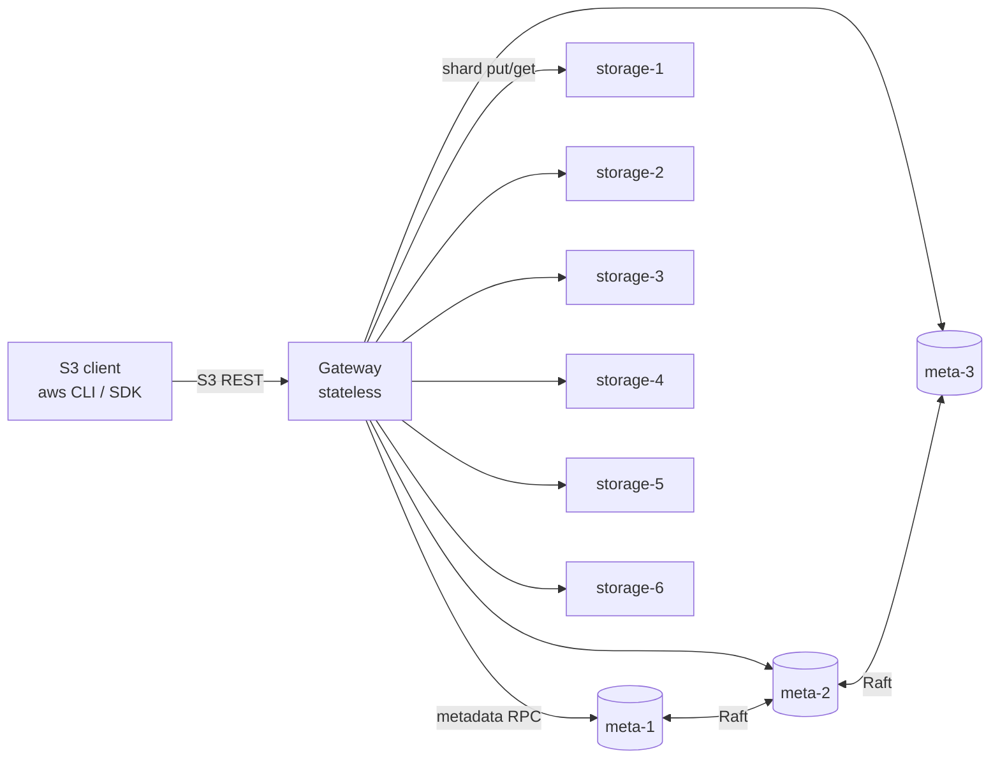
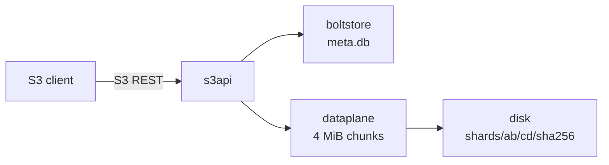

# S3-Object-Store

A distributed, S3-compatible object store written in Go: a stateless gateway,
a 3-node Raft metadata service, and storage nodes holding content-addressed
shards protected by Reed-Solomon erasure coding (4+2) or 3x replication.

> **Status: M1 (single-node store).** The gateway serves the S3 API from one
> process, with BoltDB metadata and shards on local disk. Raft (M2),
> distribution (M3), erasure coding (M4) and the rest are not built yet. The
> metadata and storage services in docker-compose only answer health checks
> for now.

## Architecture (target)



* **Gateway**: speaks a subset of the S3 REST API and streams data; it never
  buffers a whole object.
* **Metadata**: buckets, keys, chunk/shard locations and multipart state, with
  linearizable writes through Raft and BoltDB as the state machine.
* **Storage nodes**: immutable shards addressed by SHA-256, fsynced before
  being acknowledged and verified on every read.

### What M1 runs today



## Supported S3 API (M1)

| Area | Operations |
|---|---|
| Buckets | CreateBucket, DeleteBucket, HeadBucket, ListBuckets, GetBucketLocation |
| Objects | PutObject, GetObject (single `Range`, `response-*` overrides, conditional headers), HeadObject, DeleteObject |
| Listing | ListObjectsV2 with `prefix`, `delimiter`, `max-keys`, `start-after`, continuation tokens, `encoding-type=url` |
| Integrity | `Content-MD5`; `x-amz-checksum-{crc32,crc32c,crc64nvme,sha1,sha256}` as a header or an aws-chunked trailer; `x-amz-content-sha256` when it is a real digest |
| Uploads | Plain bodies and `aws-chunked` streaming bodies (signed or unsigned, with or without trailers) |

The API uses path-style addressing only. These return `NotImplemented`:
multipart upload (M5), CopyObject, ListObjects v1, versioning, ACLs, tagging
and the other bucket subresources. Authentication is not checked until M6.

## Key design decisions

1. **Chunks.** Objects are split into chunks of at most 4 MiB. A read loads
   one chunk, verifies its SHA-256, and only then sends its bytes. Corrupt data
   is never streamed to a client, and memory per request is bounded by one
   chunk. The cost is that a small Range GET still reads the whole chunk it
   falls in.
2. **Content addressing.** Shards are named by their SHA-256, so writes are
   idempotent and identical chunks are stored once. Because shards can be
   shared, DeleteObject removes only metadata. Disk space comes back through
   garbage collection (M5), which is not built yet, so in M1 deleted and
   overwritten objects still use disk.
3. **Commit order.** Shards are written to a temp file, fsynced, renamed into
   place and the directory fsynced. Only then is metadata committed. A crash
   in between leaves orphan shards, never metadata pointing at missing data.
   On Windows, directory fsync is skipped (it is not supported there); the
   Linux containers do it.
4. **Shard locations live in metadata.** Consistent hashing (M3) only picks
   nodes for new writes and repairs, so changing cluster membership never makes
   existing data unreadable.
5. **No path cleaning.** The S3 handler is mounted outside `http.ServeMux`, so
   keys like `a//b` and `x/../y` are stored verbatim. Health checks live at
   `/_health`, which can never be a valid bucket name.

## Layout

```
cmd/{gateway,metadata,storage}   service entry points
internal/s3api                   S3 REST handlers, XML, errors, aws-chunked, checksums, ranges
internal/dataplane               object <-> chunk streaming, verified reads
internal/storage                 Storage interface; disk/ backend; storagetest/ conformance suite
internal/metadata                Metadata interface; boltstore/ BoltDB implementation
internal/placement               Placement interface (implementation in M3)
internal/httpserv                shared HTTP lifecycle, health checks, probes
test/integration                 aws-sdk-go-v2 suite against an in-process gateway
scripts/                         curl and aws CLI smoke tests
deploy/                          Dockerfile, docker-compose
```

## Running

Requires Go 1.27+, GNU Make, and Docker for the cluster.

```bash
make run       # single gateway on :9000, data under ./data/gateway
make up        # docker-compose cluster (gateway on :9000)
make smoke     # curl-based smoke test against :9000
make down      # stop the cluster and delete its volumes
```

With the aws CLI:

```bash
aws --endpoint-url http://localhost:9000 s3 mb s3://demo
aws --endpoint-url http://localhost:9000 s3 cp ./file.txt s3://demo/file.txt
aws --endpoint-url http://localhost:9000 s3 ls s3://demo/
```

Any access key works until SigV4 lands in M6. Files of 8 MiB or more need
multipart upload (M5) when sent with `aws s3 cp`.

## Testing

```bash
make lint      # gofmt check, go vet, staticcheck
make race      # go test -race ./...
make cover     # coverage of internal/... across unit and integration tests
make fuzz      # native Go fuzzing: listing pagination, aws-chunked decoder, Range parser
make vuln      # govulncheck: known vulnerabilities in dependencies and stdlib
make sec       # gosec static security analysis
make ci        # lint + race + vuln + sec
```

gosec runs with no rules disabled. The three intentional findings (MD5 for
S3 ETags and Content-MD5, SHA-1 for S3's `x-amz-checksum-sha1`) are annotated
on the line with `#nosec` and a reason.

CI runs lint, race tests, coverage, govulncheck and gosec. It then starts the docker-compose
cluster and runs the curl and aws CLI smoke tests against it.

## Benchmarks

Not measured yet. See `BENCHMARKS.md` once M7 is complete.
