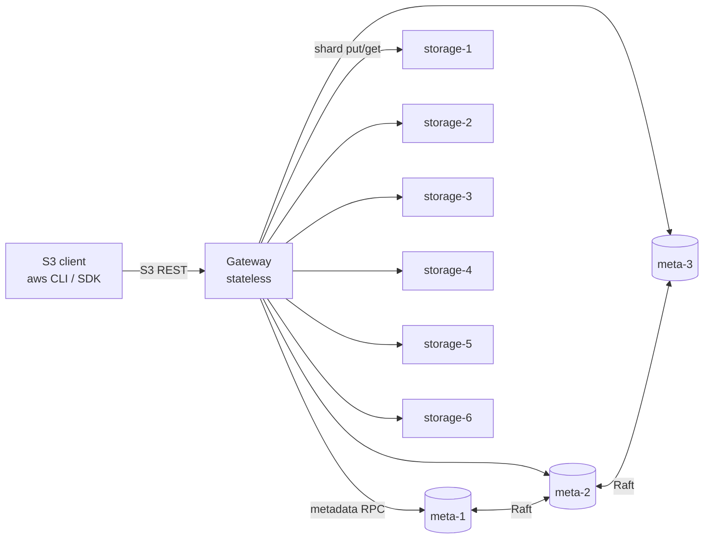
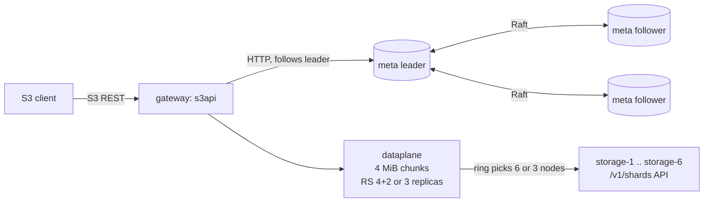

# S3-Object-Store

A distributed, S3-compatible object store written in Go: a stateless gateway,
a 3-node Raft metadata service, and storage nodes holding content-addressed
shards protected by Reed-Solomon erasure coding (4+2) or 3x replication.

> **Status: M0–M7 complete.**
> - Metadata is replicated across a 3-node Raft cluster.
> - Objects of 1 MiB or more are stored with Reed-Solomon 4+2, smaller
>   ones with 3x replication; every shard is verified on read.
> - Multipart upload, background repair and GC, SigV4 authentication and
>   Prometheus metrics are in place.
> - Scripted chaos runs found no lost or corrupted acknowledged writes, and
>   every performance number is measured. See [BENCHMARKS.md](BENCHMARKS.md).

## Architecture (target)



* **Gateway**: speaks a subset of the S3 REST API and streams data; it never
  buffers a whole object.
* **Metadata**: buckets, keys, chunk/shard locations and multipart state, with
  linearizable writes through Raft and BoltDB as the state machine.
* **Storage nodes**: immutable shards addressed by SHA-256, fsynced before
  being acknowledged and verified on every read.

### What runs today



Without `-meta` and `-storage`, the gateway runs single-node, with metadata
and one copy of each shard in `-data`.

## Supported S3 API

| Area | Operations |
|---|---|
| Buckets | CreateBucket, DeleteBucket, HeadBucket, ListBuckets, GetBucketLocation |
| Objects | PutObject, GetObject (single `Range`, `response-*` overrides, conditional headers), HeadObject, DeleteObject |
| Listing | ListObjectsV2 with `prefix`, `delimiter`, `max-keys`, `start-after`, continuation tokens, `encoding-type=url` |
| Integrity | `Content-MD5`; `x-amz-checksum-{crc32,crc32c,crc64nvme,sha1,sha256}` as a header or an aws-chunked trailer; `x-amz-content-sha256` when it is a real digest |
| Uploads | Plain bodies and `aws-chunked` streaming bodies (signed or unsigned, with or without trailers) |
| Multipart | CreateMultipartUpload, UploadPart, CompleteMultipartUpload, AbortMultipartUpload, ListParts; ETag `md5-of-md5s-N`; 5 MiB minimum part size |

| Auth | AWS Signature V4: `Authorization` header, presigned URLs, signed streaming chunks (`STREAMING-AWS4-HMAC-SHA256-PAYLOAD[-TRAILER]`) |

The API uses path-style addressing only. These return `NotImplemented`:
CopyObject, UploadPartCopy, ListMultipartUploads, ListObjects v1,
versioning, ACLs, tagging and the other bucket subresources. There are no
per-key permissions: any configured key can do everything.

## Metadata replication (Raft)

* **State machine.** Every mutation is a `Command` (CreateBucket,
  DeleteBucket, PutObject, DeleteObject) carrying its own timestamps, so
  applying it is deterministic. The single-node store and the Raft state
  machine run the same `Apply` code.
* **Persistent state machine.** BoltDB records the last applied Raft index in
  the same transaction as each mutation. On restart Raft does not reload the
  snapshot (`NoSnapshotRestoreOnStart`), and replayed entries at or below the
  stored index are skipped. If the state machine file is lost, the node
  restores its newest snapshot and replays the log.
* **Snapshots** are a consistent BoltDB copy (`tx.WriteTo`) taken without
  blocking writers. A follower that falls behind the leader's retained log
  catches up by installing one.
* **Writes** go to the leader. Followers answer `421` with the leader's
  address, and the client follows it. A write is acknowledged only after Raft
  commits and applies it. Without a quorum, writes fail with
  `ServiceUnavailable` and are never acknowledged.
* **Reads are linearizable.** Each read waits for a Raft barrier issued after
  it arrived, so it sees every write acknowledged before it started.
  Concurrent reads share one barrier. The cost is a log round-trip per batch
  of reads; a lease or ReadIndex optimisation would remove it.
* **Unknown outcomes.** If leadership is lost after an entry was appended,
  the outcome is unknown and the client retries. PutObject and DeleteObject
  are idempotent. For CreateBucket and DeleteBucket, a retry that sees its own
  earlier success reports success.
* **Membership is static**, passed with `-peers id@raftaddr@httpurl,...`.
  Nodes with no state bootstrap from it. Adding or removing members at
  runtime is not supported.

## Placement, replication and rebalancing

* **Ring.** Consistent hashing with 128 virtual nodes per storage node; the
  hash is the first 8 bytes of SHA-256. The ring key of a chunk is
  `bucket/key/versionID/chunkIndex`, so each chunk of an object is placed
  independently. Tests check an even spread and that adding a 7th node moves
  only about 1/7 of placements, all onto the new node.
* **Writes.** Each chunk goes to the first 3 healthy nodes the ring picks,
  in parallel. A node that fails is marked down and replaced by the next one
  on the ring. A chunk is acknowledged only when 3 copies are stored
  (fsynced); with fewer than 3 healthy nodes the PUT fails.
* **Reads.** Replicas are tried healthy-first. Each is verified (SHA-256) on
  the gateway before use, so a missing, corrupt or unreachable copy is
  skipped. Losing any 2 of a chunk's 3 replicas is survivable.
* **Health.** Nodes are probed every second, and any `ErrUnavailable` marks a
  node down for a cooldown. Per-node clients have short connect and header
  timeouts, so a dead node is abandoned quickly.
* **Rebalancing** (`POST /_admin/rebalance`). For each chunk, a shard on a
  node the ring no longer picks is copied (verified) to a picked node, then
  moved in metadata with a conditional update. A move fails safely if the
  object was overwritten or the shard already moved. Old copies are left for
  GC (M5). Reads stay correct throughout, because metadata keeps pointing at
  a location that holds the data until the move commits.
* **Not built yet:** removing a node (needs repair, M5), and automatic
  rebalancing (it is triggered by an operator).

## Erasure coding

* **Scheme choice.** An object whose declared size is at least 1 MiB (or
  unknown) is erasure coded RS(4,2), as long as the cluster has at least 6
  storage nodes. Smaller objects are replicated 3x, because 6 shards of a
  tiny object cost more than 3 copies and every read would touch 4 nodes.
* **Layout.** Each chunk (up to 4 MiB) becomes 4 data shards of
  `ceil(size/4)` bytes (the last zero-padded) plus 2 parity shards. Shard i
  goes on the ring's i-th node for that chunk, so all 6 are on distinct
  nodes. Each shard is content-addressed by its own SHA-256.
* **Reads** fetch the 4 data shards in parallel. Only if one is missing,
  corrupt or unreachable are the parity shards fetched and the data
  reconstructed. Any 2 of the 6 shards can be lost; with 3 lost the read fails
  with `503 ServiceUnavailable` (nodes unreachable) or `500 InternalError`
  (data corrupt) before any bytes of that chunk are sent.
* **Writes while nodes are down.** All 6 shards are written when 6
  distinct healthy nodes exist. If not, a chunk is accepted with 5 shards
  (it still survives one more failure), and the missing shard is recorded as
  unplaced for repair to rebuild (M5). With fewer than 5 healthy nodes,
  writes are refused.
* **Overhead.** Measured in `TestStorageOverhead`, on whole chunks: 1.5
  bytes on disk per logical byte for RS(4,2), against 3.0 for 3x
  replication.

## Multipart, repair and garbage collection

* **Multipart.** Uploads and parts live in the Raft state machine. Each part
  is chunked and placed like an object, under its own placement key. Complete
  checks part order, each part's ETag and the minimum part size (5 MiB for
  every part but the last), then builds the object's chunk list in a single
  Raft command, so it either fully happens or not at all. The upload ID is
  chosen by the proposer, so a retried CreateMultipartUpload or Complete can
  recognise its own earlier success.
* **Repair** (every `-repair-interval`, or `POST /_admin/repair`). A shard
  needs repair if it was never placed, its node is down, the node does not
  have it, or (with `-deep-repair`) its bytes fail SHA-256. Replicas are
  copied from a verified good copy; erasure-coded shards are reconstructed
  from any 4 verified shards, and the result is checked against the recorded
  checksum. A shard lost or corrupted on a live node is rewritten on that
  node. Otherwise it goes to a healthy node that holds no other shard of the
  chunk, and the move is committed with a conditional metadata update. Repair
  reports chunks it cannot fix (too few shards left) and chunks with no
  eligible node (for example RS(4,2) on exactly 6 nodes with one down) instead
  of failing.
* **GC** (every `-gc-interval`, or `POST /_admin/gc`) is mark-and-sweep. It
  marks every (node, shard) referenced by committed objects and in-progress
  parts, then deletes unreferenced shards older than `-gc-grace` (default
  1h). Three rules keep this safe:
  - Data is written before the metadata that references it, so uncommitted
    uploads are protected by the grace period.
  - Deletes are conditional on the shard still being older than the cutoff.
  - A write that reuses an existing (deduplicated) shard refreshes its
    timestamp under the same per-shard lock.

  `TestReusedOrphanNotDeleted` covers the race these rules close: an old
  orphan being reused by an upload that has not committed yet.

## Authentication and observability

* **SigV4.** Credentials are static access-key/secret pairs, passed in
  `S3OS_CREDENTIALS="key:secret,..."` (environment, so secrets never
  appear in process listings). With credentials set, every S3 request must
  be signed. The verifier rebuilds the canonical request and compares
  signatures in constant time. It rejects:
  - clock skew over 15 minutes;
  - expired presigned URLs;
  - an unsigned `host` header;
  - signed streaming uploads whose chunk signature chain breaks (a
    tampered, reordered or dropped chunk), before anything is committed.

  It is checked against six request examples published in AWS's S3
  documentation, and end to end with the aws SDK (normal requests, presigned
  URLs) and curl's own `--aws-sigv4` implementation. With no credentials the
  gateway logs a warning and accepts anonymous requests (development only).
* **Admin API** (`/_admin/rebalance`, `/_admin/repair`, `/_admin/gc`)
  needs `Authorization: Bearer $S3OS_ADMIN_TOKEN` when auth is on, and is
  disabled if no token is set.
* **Metrics** are served at `/_metrics` on every process:

  | Process | Metrics |
  |---|---|
  | gateway | `s3_requests_total{op,code}`, `s3_request_duration_seconds{op}` (histogram), `s3_bytes_in_total`, `s3_bytes_out_total` |
  | gateway | `storage_shard_read_failures_total{node,reason}`, `storage_nodes_down` |
  | gateway | `repair_queue_depth`, `repair_shards_rebuilt_total`, `repair_chunks_unrecoverable_total`, `repair_passes_total`, `gc_shards_deleted_total`, `gc_bytes_freed_total` |
  | storage nodes | request counts and latency for the shard API |
  | metadata nodes | the same, plus `raft_is_leader`, `raft_term`, `raft_commit_index`, `raft_applied_index`, `raft_last_snapshot_index` |

  Every process also exports Go runtime and process metrics.
* **Logs** are JSON (`log/slog`), one line per S3 request with request id,
  operation, bucket, key, access key, remote address, status, bytes in/out
  and duration. Use `-log-level` to change verbosity.

## Key design decisions

1. **Chunks.** Objects are split into chunks of at most 4 MiB. A read loads
   one chunk, verifies its SHA-256, and only then sends its bytes. Corrupt data
   is never streamed to a client, and memory per request is bounded by one
   chunk. The cost is that a small Range GET still reads the whole chunk it
   falls in.
2. **Content addressing.** Shards are named by their SHA-256, so writes are
   idempotent and identical chunks are stored once. Because shards can be
   shared, DeleteObject removes only metadata. Disk space comes back through
   garbage collection (M5), which is not built yet, so in M1 deleted and
   overwritten objects still use disk.
3. **Commit order.** Shards are written to a temp file, fsynced, renamed into
   place and the directory fsynced. Only then is metadata committed. A crash
   in between leaves orphan shards, never metadata pointing at missing data.
   On Windows, directory fsync is skipped (it is not supported there); the
   Linux containers do it.
4. **Shard locations live in metadata.** Consistent hashing (M3) only picks
   nodes for new writes and repairs, so changing cluster membership never makes
   existing data unreadable.
5. **No path cleaning.** The S3 handler is mounted outside `http.ServeMux`, so
   keys like `a//b` and `x/../y` are stored verbatim. Health checks live at
   `/_health`, which can never be a valid bucket name.

## Layout

```
cmd/{gateway,metadata,storage}   service entry points
internal/s3api                   S3 REST handlers, XML, errors, aws-chunked, checksums, ranges
internal/dataplane               object <-> chunk streaming, verified reads
internal/storage                 Storage interface; disk/ backend; storagetest/ conformance suite
internal/metadata                Metadata interface; boltstore/ state machine; raftmeta/ Raft node,
                                 HTTP API and leader-following client; metadatatest/ conformance suite
internal/placement               consistent-hash ring with virtual nodes
internal/erasure                 Reed-Solomon encode/reconstruct (klauspost/reedsolomon)
internal/storagenode             storage node HTTP API and client (end-to-end verified reads)
internal/rebalance               moves shards to match the ring after membership changes
internal/repair                  rebuilds missing/corrupt shards (copy or Reed-Solomon reconstruct)
internal/gc                      mark-and-sweep deletion of unreferenced shards
internal/sigv4                   AWS Signature V4 verification (header, presigned, streaming chunks)
internal/metrics                 Prometheus metrics
bench/loadgen                    S3 load generator (stdlib + own SigV4 signer), report generator
bench/run.sh, bench/warp.sh      benchmark scenarios 1-7 and the MinIO warp cross-check
bench/results/                   raw benchmark and chaos output
test/chaos                       fault injection + durability check against the docker cluster
scripts/chaos.sh, scripts/demo.sh  chaos runner; aws CLI demo with a node killed mid-upload
internal/gateway                 assembles metadata, data plane, S3 API and admin endpoints
internal/httpserv                shared HTTP lifecycle, health checks, probes
test/integration                 aws-sdk-go-v2 suite against an in-process gateway
scripts/                         curl and aws CLI smoke tests
deploy/                          Dockerfile, docker-compose
```

## Running

Requires Go 1.27+, GNU Make, and Docker for the cluster.

```bash
make run       # single gateway on :9000, data under ./data/gateway
make up        # docker-compose cluster (gateway on :9000)
make smoke     # curl-based smoke test against :9000
make down      # stop the cluster and delete its volumes
```

With the aws CLI:

```bash
aws --endpoint-url http://localhost:9000 s3 mb s3://demo
aws --endpoint-url http://localhost:9000 s3 cp ./file.txt s3://demo/file.txt
aws --endpoint-url http://localhost:9000 s3 ls s3://demo/
```

docker-compose starts the gateway with the development credentials
`test-access-key` / `test-secret-key` (set them with `aws configure` or
`AWS_ACCESS_KEY_ID`/`AWS_SECRET_ACCESS_KEY`). `aws s3 cp` uploads files of
8 MiB or more with multipart.

## Testing

```bash
make lint      # gofmt check, go vet, staticcheck
make race      # go test -race ./...
make cover     # coverage of internal/... across unit and integration tests
make integration-raft     # the S3 integration suite with metadata in a 3-node Raft cluster
make integration-cluster  # ... and with shards replicated across 6 HTTP storage nodes
make fuzz      # native Go fuzzing: listing pagination, aws-chunked decoder, Range parser, erasure round trip
make vuln      # govulncheck: known vulnerabilities in dependencies and stdlib
make sec       # gosec static security analysis
make ci        # lint + race + vuln + sec
```

gosec runs with no rules disabled. The three intentional findings (MD5 for
S3 ETags and Content-MD5, SHA-1 for S3's `x-amz-checksum-sha1`) are annotated
on the line with `#nosec` and a reason.

CI runs lint, race tests, coverage, the integration suite in both metadata
modes, govulncheck and gosec. It then starts the docker-compose
cluster and runs the curl and aws CLI smoke tests, the failover smoke test
and the aws CLI demo against it.

## Benchmarks and chaos results

All numbers are medians of 3 runs on one laptop (i7-13620H, 16 GB, NVMe,
Windows 11 + Docker Desktop/WSL2), with all 10 containers sharing one CPU
and one virtual disk. [BENCHMARKS.md](BENCHMARKS.md) has the method, raw
outputs, exact commands and what limits these numbers. A sample:

| measurement | result |
|---|---|
| GET 1 MiB, 8 clients | 408.4 MB/s, p99 49.15 ms |
| PUT 1 MiB (erasure coded), 8 clients | 44.5 MB/s, p99 907.53 ms |
| GET 1 MiB with 2 of 6 storage nodes down | 227.5 MB/s, p99 107.57 ms (healthy: 250.7 MB/s) |
| Repair after wiping a node (537 MB of shards) | 16.32 s, 32.9 MB/s rebuilt |
| Raft leader kill: longest write stall | 3.7 s median (one run 8.9 s) |
| Bytes on disk per logical byte | 1.500 (RS 4+2) vs 3.000 (3x replication) |
| Chaos: 3 runs, 6 fault types each | 5,980 acknowledged writes, 5,980 verified, 0 mismatches |

```bash
RUNS=3 bash bench/run.sh            # benchmark scenarios 1-7
bash scripts/chaos.sh 3             # chaos + durability
bash scripts/demo.sh                # aws CLI demo (needs the aws CLI)
```
